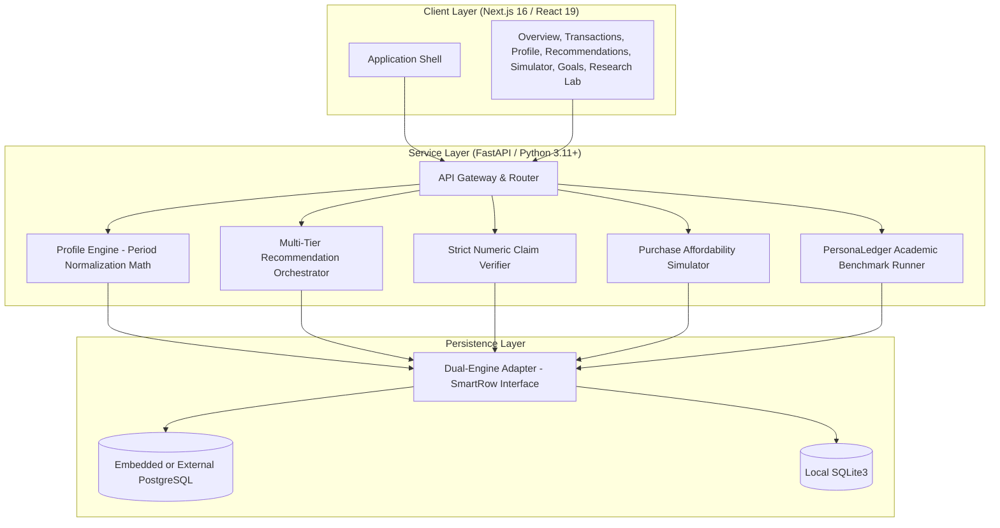

<div align="center">
  
  <h1>FinSight AI</h1>
  <p>Evidence-grounded personal finance decision support and reproducible evaluation platform.</p>

  <p>
    <a href="https://finsight-wine-tau.vercel.app/">Production Web Client</a> &bull;
    <a href="https://finsight-api-d84z.onrender.com/docs">Interactive API Documentation</a> &bull;
    <a href="https://github.com/sriram36/FinSight">Source Repository</a>
  </p>

  <p>
    
    
    
    
    
  </p>
</div>

---

## Technical Documentation Suite

Detailed architectural, mathematical, and operational specifications are maintained in the `docs/` directory:

| Specification | Description |
| :--- | :--- |
| [System Architecture & Invariants](docs/ARCHITECTURE.md) | Period-normalized math formulation, zero-baseline safety, claim verifier AST parser, and storage drivers. |
| [PersonaLedger & Research Methodology](docs/RESEARCH_LAB.md) | Deterministic 1,000-row benchmark, 10 financial personas, zero-leakage 70/30 temporal holdout, and perturbation testing. |
| [REST API Specification](docs/API_REFERENCE.md) | Complete OpenAPI endpoint catalog, request and response contracts, query filters, and error schemas. |
| [Production Deployment Handbook](docs/DEPLOYMENT_GUIDE.md) | Step-by-step operations runbook for Render All-in-One Docker, Vercel edge runtime, and Docker Compose. |

---

## Overview & Core Problem

Large language models generate compelling narrative prose but exhibit high failure rates when performing arithmetic aggregation, calculating runway budgets, or citing accurate monetary amounts. In personal finance, ungrounded recommendations introduce critical risks—such as proposing spending cuts to non-discretionary contractual commitments (e.g., medical insurance or lease agreements) or inventing phantom savings.

FinSight AI resolves this by enforcing a strict boundary between deterministic financial mathematics and language generation:
1. **Mathematical Isolation:** All aggregation, period normalization, and daily pacing calculations occur deterministically in Python. LLMs never compute arithmetic totals.
2. **Strict Claim Verification:** Every recommendation generated under System C must cite itemized source transaction identifiers. An automated verifier extracts every numeric token in the generated text and cross-examines it against empirical receipts within a 1.5% rounding margin.
3. **Protected Category Invariants:** Essential categories designated by the user (e.g., Healthcare, Housing) are structurally shielded. Neither the recommendation pipeline nor the purchase simulator may propose reductions to protected essentials.

---

## Architectural Topology



---

## Primary Modules

### Personal Finance Workspace
- **Overview Dashboard:** Executive financial snapshot displaying total income, expenses, net cashflow trajectory, available balance, goal pacing, and latest verified recommendation.
- **Statement Ingestion & Deduplication:** Drag-and-drop CSV/JSON importer with automatic bank header detection, client-side column mapping confirmation, and SHA-256 duplicate transaction elimination.
- **Transactions Ledger:** Complete ledger history with multi-filter search, direction categorization, manual entry, inline editing, and deletion.
- **Smart Budgeting:** Category-level monthly spending limits, real-time progress bars, default vs. month-specific override rules, and overrun alerts.
- **Subscriptions & Recurring Payments:** Intelligent recurring charge detection (interval, merchant, amount), upcoming 30-day payment schedule, and cancel/pause status management.
- **Unusual Spending (Anomaly Detection):** Statistical outlier detection via Z-Score and Isolation Forest with human-in-the-loop review lifecycle (`new`, `reviewed`, `confirmed_unusual`, `dismissed`).
- **Cash Flow Forecast:** 30-, 60-, and 90-day balance projections factoring historical spending pace, variable expense volatility, and upcoming recurring bills.
- **Monthly Financial Review:** Month-over-month executive review comparing income, spending, net savings, and category shifts with plain-language AI explanation.
- **Ask FinSight (Conversational Copilot):** Natural language conversational assistant computing ledger answers deterministically with automated claim verification fallback.
- **Multi-System Recommendation Viewer (R1–R4):** 
  - *System A (R1):* Deterministic 25% threshold rule against top discretionary category.
  - *System B (R2):* Profile-conditioned rule engine.
  - *System B-Ablation:* Unstructured heuristic baseline.
  - *System C (R3):* Full evidence-grounded generative advice with itemized source transaction IDs and strict numeric claim verification.
  - *Personalized (R4):* Tailored recommendations respecting user-protected categories.
- **Purchase Affordability Simulator:** Evaluates prospective purchases against liquidity, upcoming recurring commitments, emergency reserves, and active savings goals.
- **Goal Management & Invariant Protection:** Goal tracking with shortfall estimation and contractual category protection toggles.

### Synthetic Research Laboratory
- **PersonaLedger Dataset:** Deterministic 1,000-row synthetic ledger across 10 distinct consumer profiles (seed `42`) to support zero-leakage academic evaluation.
- **70/30 Temporal Holdout:** Chronological partition ensuring baseline observations strictly precede evaluation data:
  $$\max(\text{Baseline Dates}) < \min(\text{Holdout Dates})$$
- **Controlled Perturbation Runner:** Injects controlled $+150\%$ spending shocks into holdout categories to benchmark system anomaly detection sensitivity and verifier fidelity.

---

## Local Development Quickstart

### Prerequisites
- Python 3.11+
- Node.js 20+ and npm

### 1. Backend Service
```bash
# Clone repository
git clone https://github.com/sriram36/FinSight.git
cd FinSight

# Create virtual environment
python -m venv .venv

# Activate virtual environment
# Windows:
.\.venv\Scripts\activate
# Linux / macOS:
source .venv/bin/activate

# Install dependencies
pip install -r backend/requirements.txt

# Execute test suite (60 tests)
pytest backend/tests/ -v

# Start FastAPI development server
uvicorn backend.main:app --reload --host 0.0.0.0 --port 8000
```
API endpoints and OpenAPI documentation are available at `http://localhost:8000/docs`.

### 2. Frontend Web Application
In a separate terminal:
```bash
# Install frontend dependencies
npm install

# Run static TypeScript analysis
npx tsc --noEmit

# Start Next.js development server
npm run dev
```
The web application is accessible at `http://localhost:3000`.

---

## Containerized Deployment

### Full-Stack Docker Compose (Local or VPS)
Launch both services with persistent storage via a single command:
```bash
docker compose up --build -d
```
- Frontend: `http://localhost:3000`
- Backend API: `http://localhost:8000/docs`
- Persistent SQLite Volume: `./data/finsight.db`

### Production Cloud Architecture
- **Backend on Render:** Built via `Dockerfile` or `Dockerfile.backend`. Features an embedded PostgreSQL server managed by `entrypoint.sh` for zero-setup, self-contained database persistence. Automatically binds to Render's dynamic `$PORT`.
- **Frontend on Vercel:** Next.js 16 with edge route optimization. Configured with environment variable `NEXT_PUBLIC_API_BASE_URL` pointing to the Render backend service.

Detailed walkthroughs are provided in the [Production Deployment Handbook](docs/DEPLOYMENT_GUIDE.md).

---

## Automated Test Verification

All mathematical transformations, API routers, database adapters, and claim verifiers are covered by automated unit and integration tests:

```bash
# Run complete test suite (34 tests)
pytest backend/tests/ -v

# Run full-system end-to-end user journey test
pytest backend/tests/test_e2e_flow.py -v

# Run PostgreSQL adapter compatibility suite
pytest backend/tests/test_postgres_compatibility.py -v

# Run research benchmark evaluation test
pytest backend/tests/test_research_lab.py -v
```

---

## License

This software is released under the [MIT License](LICENSE).
