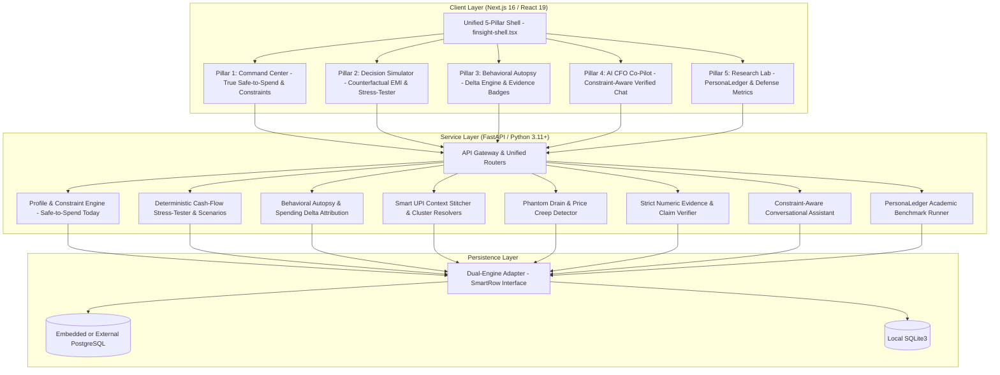

<div align="center">
  
  <h1>FinSight AI</h1>
  <p>Unbiased Financial Defense & Pre-Decision Intelligence Co-Pilot with Reproducible Evaluation Platform.</p>

  <p>
    <a href="https://finsight-wine-tau.vercel.app/">Production Web Client</a> &bull;
    <a href="https://finsight-api-d84z.onrender.com/docs">Interactive API Documentation</a> &bull;
    <a href="https://github.com/sriram36/FinSight">Source Repository</a>
  </p>

  <p>
    
    
    
    
    
  </p>
</div>

---

## Technical Documentation Suite

Detailed architectural, mathematical, and operational specifications are maintained in the `docs/` directory:

| Specification | Description |
| :--- | :--- |
| [System Architecture & Invariants](docs/ARCHITECTURE.md) | Period-normalized math formulation, zero-baseline safety, claim verifier AST parser, and storage drivers. |
| [PersonaLedger & Research Methodology](docs/RESEARCH_LAB.md) | Deterministic 1,000-row benchmark, 10 financial personas, zero-leakage 70/30 temporal holdout, and perturbation testing. |
| [REST API Specification](docs/API_REFERENCE.md) | Complete OpenAPI endpoint catalog, request and response contracts, query filters, and error schemas. |
| [Production Deployment Handbook](docs/DEPLOYMENT_GUIDE.md) | Step-by-step operations runbook for Render All-in-One Docker, Vercel edge runtime, and Docker Compose. |

---

## Overview & Core Philosophy Shift

Traditional personal finance tools act as passive post-mortem recorders—merely showing charts of where money was already lost. Furthermore, generic LLM-based assistants hallucinate numbers, miscalculate balances, and suggest ungrounded spending cuts to non-discretionary commitments.

**FinSight AI transforms personal finance into an Unbiased Financial Defense & Pre-Decision Co-Pilot** structured around **4 Core Closed-Loop Product Pillars + The Research Lab**:
1. **Mathematical Isolation & Invariant Protection:** Arithmetic, runway budgets, and cash-flow stress tests run deterministically in Python. Protected categories and user constraints are inviolable contractual rules.
2. **Strict Claim & Evidence Verification:** Every AI-generated insight must bind to empirical transaction IDs with numeric verification (within 1.0% rounding tolerance).
3. **Pre-Purchase Counterfactual Sandbox:** Validates large purchases and EMI stress tests before money leaves the bank.
4. **Academic Research Reproducibility:** Preserves an end-to-end benchmark lab with temporal holdouts and perturbation studies.

---

## Architectural Topology (4 Core Pillars + Research Lab)



---

## 5 Core Product Pillars

### Pillar 1: Command Center (`overview-view.tsx`)
- **True Safe-to-Spend Today (₹/day):** Replaces static bank balances with real-time safe daily spending:
  $$\text{Safe Daily Spend} = \frac{\text{Raw Balance} - \text{Unpaid Fixed Obligations} - \text{Hard Floor Buffer} - \text{Essential Burn}}{\text{Remaining Days in Billing Cycle}}$$
- **Persistent Constraint Memory:** Real-time interactive constraint management for `HARD_FLOOR` (emergency liquidity buffer), `FIXED_OBLIGATION` (rent, hostel fees, remittances), `BEHAVIORAL_CAP` (e.g., max 2 late-night orders/week), and `PENDING_IOU` (split bills owed to the user).
- **Smart UPI Context Stitcher:** Clusters ambiguous P2P UPI transfers by time-of-day (commute, lunch, late-night) and handle frequency, offering 1-tap categorization or split-bill IOU creation.
- **Consolidated Sub-Tabs:** Fast navigation between Executive Command Center, Ledger Transactions, Smart Budgets, and Profile Invariants.

### Pillar 2: Counterfactual Decision Simulator (`simulate-view.tsx`)
- **"Can I Afford This?" Sandbox:** Evaluates prospective one-time or EMI purchases over 30–90 days against historical daily burn velocity, recurring commitments, and active constraints.
- **Deterministic Stress-Testing:** Computes real liquidity **survival probability** (0–100%) and pinpoints exact constraint violations (e.g., *"Breaches ₹5,000 Hard Floor on Day 18 due to Rent"*).
- **Runway Timeline & Alternatives:** Displays Before vs. After liquidity runway bars and generates counterfactual alternatives (*"Delay purchase by 11 days"*, *"Opt for 3-month EMI"*, or *"Reduce dining velocity by ₹75/day"*).
- **Consolidated Sub-Tabs:** Direct switching to 30-Day Forecast projections and Goal Feasibility tracking.

### Pillar 3: Behavioral Autopsy (`review-view.tsx`)
- **Root-Cause Spending Change Attribution (Delta Engine):** Decomposes spending shifts against baseline periods into **Frequency Drift** (ordering more often) vs. **Ticket-Size Inflation** (buying pricier items).
- **Late-Night Velocity Firewall:** Automatically monitors and flags high-risk micro-bleeds occurring between 10:30 PM and 2:00 AM.
- **Phantom Drain Hunter:** Detects unannounced subscription price hikes (e.g., Netflix drift from ₹649 to ₹799) and overlapping recurring mandates.
- **Evidence Verification Badges:** Every insight card includes a verified trust badge. Clicking the badge reveals a citation drawer displaying exact supporting transaction receipts.
- **Consolidated Sub-Tabs:** Direct navigation to Phantom Drains, Anomaly Review, and Verified Recommendations.

### Pillar 4: Constraint-Aware AI CFO Co-Pilot (`chat-view.tsx`)
- **Conversational Defense Engine:** An AI CFO co-pilot that answers financial queries deterministically from the database ledger.
- **Active Constraint Memory Panel:** Dual-column UI with a live side panel tracking active inviolable constraints and offering 1-tap constraint injection suggestions.
- **Strict Citation Grounding:** Answers are checked against `verifier_service.py` to prevent arithmetic hallucinations and ungrounded claims.

### Pillar 5: Synthetic Research Laboratory (`research-view.tsx`)
- **PersonaLedger Dataset:** Deterministic 1,000-row synthetic ledger across 10 distinct consumer profiles (seed `42`) supporting zero-leakage academic evaluation.
- **70/30 Temporal Holdout:** Chronological partition ensuring baseline observations strictly precede evaluation data:
  $$\max(\text{Baseline Dates}) < \min(\text{Holdout Dates})$$
- **Controlled Perturbation Runner:** Injects controlled $+150\%$ spending shocks into holdout categories to benchmark system anomaly detection sensitivity and verifier fidelity.
- **Defense Engine Benchmark:** Live evaluation of Claim Verification Faithfulness, Constraint Satisfaction Accuracy, and UPI Disambiguation Coverage.

---

## Local Development Quickstart

### Prerequisites
- Python 3.11+
- Node.js 20+ and npm

### 1. Backend Service
```bash
# Clone repository
git clone https://github.com/sriram36/FinSight.git
cd FinSight

# Create virtual environment
python -m venv .venv

# Activate virtual environment
# Windows:
.\.venv\Scripts\activate
# Linux / macOS:
source .venv/bin/activate

# Install dependencies
pip install -r backend/requirements.txt

# Seed demonstration data (constraints, UPI clusters, phantom drains)
python backend/seed.py

# Execute test suite
pytest backend/tests/ -v

# Start FastAPI development server
uvicorn backend.main:app --reload --host 0.0.0.0 --port 8000
```
API endpoints and OpenAPI documentation are available at `http://localhost:8000/docs`.

### 2. Frontend Web Application
In a separate terminal:
```bash
# Install frontend dependencies
npm install

# Run static TypeScript analysis
npx tsc --noEmit

# Start Next.js development server
npm run dev
```
The web application is accessible at `http://localhost:3000`.

---

## Containerized Deployment

### Full-Stack Docker Compose (Local or VPS)
Launch both services with persistent storage via a single command:
```bash
docker compose up --build -d
```
- Frontend: `http://localhost:3000`
- Backend API: `http://localhost:8000/docs`
- Persistent SQLite Volume: `./data/finsight.db`

### Production Cloud Architecture
- **Backend on Render:** Built via `Dockerfile` or `Dockerfile.backend`. Features an embedded PostgreSQL server managed by `entrypoint.sh` for zero-setup, self-contained database persistence. Automatically binds to Render's dynamic `$PORT`.
- **Frontend on Vercel:** Next.js 16 with edge route optimization. Configured with environment variable `NEXT_PUBLIC_API_BASE_URL` pointing to the Render backend service.

Detailed walkthroughs are provided in the [Production Deployment Handbook](docs/DEPLOYMENT_GUIDE.md).

---

## Automated Test Verification

All mathematical transformations, API routers, database adapters, and claim verifiers are covered by automated unit and integration tests:

```bash
# Run complete test suite
pytest backend/tests/ -v

# Run full-system end-to-end user journey test
pytest backend/tests/test_e2e_flow.py -v

# Run PostgreSQL adapter compatibility suite
pytest backend/tests/test_postgres_compatibility.py -v

# Run research benchmark evaluation test
pytest backend/tests/test_research_lab.py -v

# Run claim verifier strict tolerance test
pytest backend/tests/test_claim_verifier.py -v

# Run affordability counterfactual stress test
pytest backend/tests/test_affordability.py -v
```

---

## License

This software is released under the [MIT License](LICENSE).
