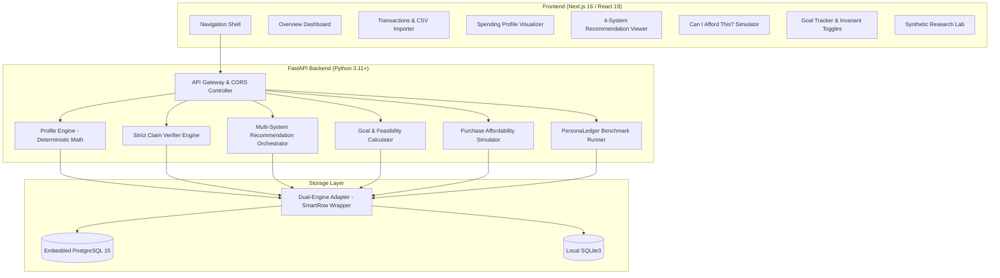

# FinSight AI: System Architecture & Core Invariants

FinSight AI is an evidence-grounded personal finance decision support platform and synthetic research benchmarking system. It is engineered around the principle of **strict mathematical determinism and empirical claim verification**: large language models and heuristic agents are never trusted with arithmetic calculations, budget aggregation, or ungrounded assertions.

---

## 1. High-Level Architecture

The platform follows a decoupled client-server architecture consisting of a Next.js 16 frontend, a FastAPI Python 3.11+ application server, and a dual-mode database engine (embedded PostgreSQL or local SQLite).



---

## 2. Core Invariants

FinSight AI operates under non-negotiable mathematical and behavioral invariants:

### Invariant 1: Deterministic Math Invariant
**No LLM prompt or generative heuristic may ever compute sums, averages, daily pacing, goal feasibility, or affordability thresholds.**  
All calculations are computed deterministically in pure Python using normalized time-series mathematics:

$$\text{Normalized Baseline Spending} = \left(\frac{B}{D_b}\right) \times D_r$$

Where:
- $B$: Aggregate baseline spending in a category over baseline window $D_b$ (days).
- $D_b$: Baseline window duration (e.g., 60 days).
- $D_r$: Recent window duration (e.g., 30 days).

#### Zero-Baseline Protection
When baseline spending $B = 0$ or $D_b = 0$, percentage delta $(\Delta\%)$ calculations are undefined. FinSight AI enforces:
- If $B = 0$ and $R > 0$: $\Delta\% = +100.0\%$ (flagged as a newly emergent spending category).
- If $B = 0$ and $R = 0$: $\Delta\% = 0.0\%$.

---

### Invariant 2: Strict Numeric Claim Verification
All generative advice produced under **System C** is subjected to adversarial numeric verification before transmission to the user. Every numeric token extracted from recommendation text must correspond to verified records in the evidence payload within a strict **1.5% margin of error** (allowing for currency rounding).

```
System C Recommendation Text:
"Reduce weekend dining outings to recover ₹4,200.00/month."
                     │
                     ▼
             Tokenizer / Regex Parser
                     │
       Extracted Tokens: [ 4200.00 ]
                     │
                     ▼
         Claim Verifier Engine
    (Evidence Source: monthly_impact = 4200.0)
                     │
          Tolerance Check: |4200.00 - 4200.00| <= 1.5%?
                     │
             [ VERIFIED: PASS ]
```

If a recommendation cites any number not present in the evidence data, verification fails (`is_verified = 0`), and the advice is flagged with diagnostic verifier notes.

---

### Invariant 3: Protected Category Invariants
Users can flag critical spending categories (such as *Healthcare*, *Rent/Housing*, or *Childcare*) as **Protected Invariants**.
- The Recommendation Engine is mathematically barred from proposing spending cuts to protected categories.
- The Purchase Simulator treats protected category obligations as rigid constraints that cannot be cannibalized to justify a discretionary purchase.

---

## 3. Four-Tier Recommendation Architecture

FinSight AI implements four distinct recommendation engines to facilitate comparative research and ablation studies:

| Configuration | Grounding | Generation Mechanism | Claim Verifier |
| :--- | :---: | :--- | :---: |
| **System A** | Rules | Deterministic threshold rule (25% reduction on top discretionary category). | Bypassed |
| **System B** | Profile | Profile-conditioned AI advice tailored to recent delta changes. | Bypassed |
| **System B-Ablation** | None | Free-form heuristic advice without empirical transaction anchors. | Failed (0% Grounding) |
| **System C** | Strict Evidence | Conditioned on spending profile, anchored with itemized source transaction IDs. | Enforced (1.5% Tolerance) |

---

## 4. Dual-Engine Database Architecture

FinSight AI employs a unified storage driver in `backend/database.py` that transparently adapts between **PostgreSQL** and **SQLite3** without modifying application logic or router queries:

1. **`SmartRow` Abstraction (`PostgresRow`):**
   - Implements index access (`row[0]`), column name access (`row["amount"]`), and dict conversion (`dict(row)`), mirroring `sqlite3.Row` behavior across both engines.
2. **Dynamic Query Translation:**
   - Parameter placeholders (`?`) in SQL queries are dynamically translated to PostgreSQL `%s` placeholders at runtime.
3. **ANSI SQL Standard Compliance:**
   - Table initialization and default seed inserts utilize standard ANSI `ON CONFLICT (id) DO NOTHING` and `ON CONFLICT (user_id, category) DO UPDATE SET...`.
