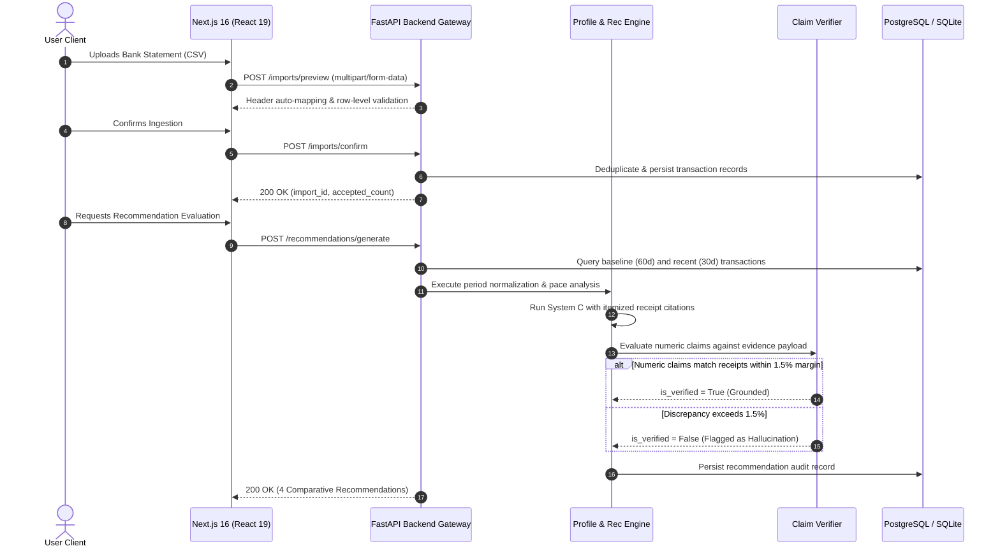
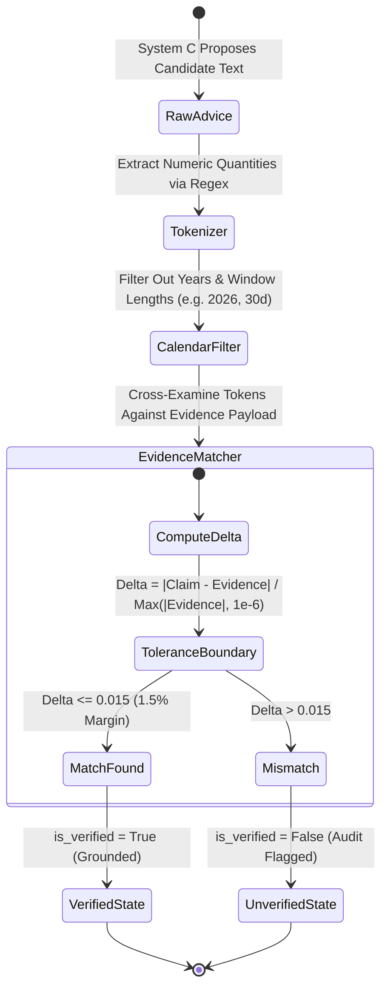
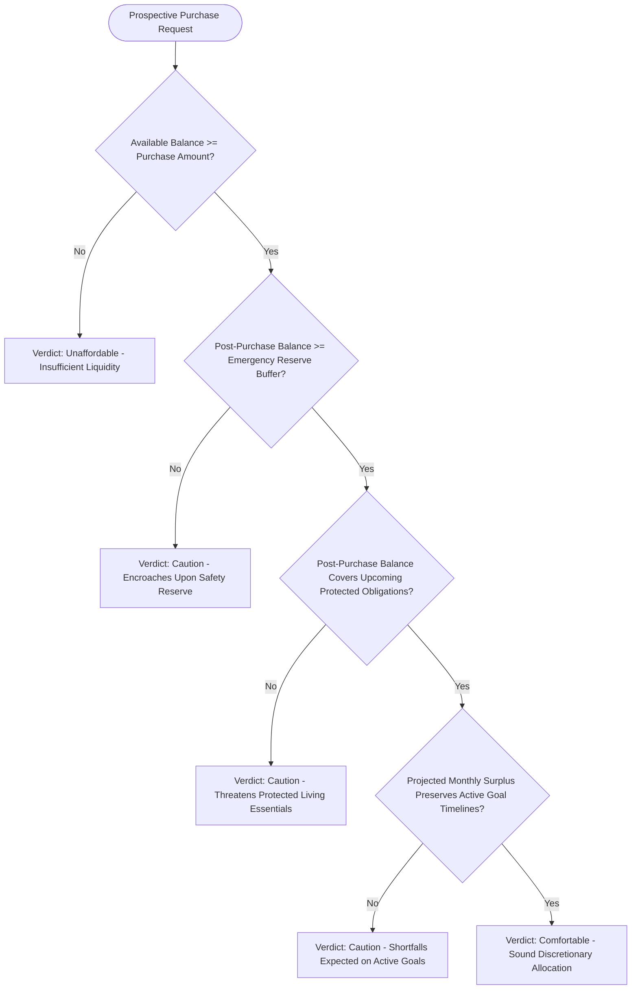

# System Architecture & Technical Invariants

FinSight AI is an evidence-grounded financial decision support system and empirical evaluation platform. The core design mandate is the elimination of arithmetic hallucination and ungrounded advice in consumer personal finance.

---

## 1. System Topology

The architecture decouples user presentation from state management and financial computation. Generative language models operate solely as natural-language translators of deterministically computed artifacts.

```
[ Client: Next.js 16 / React 19 / Turbopack ]
                     │  HTTP / REST (JSON)
                     ▼
[ API Gateway & Middleware (FastAPI / CORS / Validation) ]
   ├── Time-Series Profile Engine (Period-Normalized Mathematics)
   ├── Multi-Tier Recommendation Orchestrator (Systems A, B, B-ablation, C)
   ├── Strict Numeric Claim Verifier (AST Tokenization & Tolerance Verification)
   ├── Scenario & Affordability Simulator (Liquidity & Buffer Protection)
   └── PersonaLedger Synthetic Research Runner
                     │
                     ▼
[ Dual-Engine Storage Adapter (SmartRow Abstraction) ]
   ├── Embedded or Remote PostgreSQL 15 (Production Runtime)
   └── Local SQLite3 Engine (Development / Testing)
```

### 1.1 End-to-End Ingestion & Verification Sequence



---

## 2. Core Mathematical Invariants

### 2.1 Deterministic Normalization Formulation
Financial comparisons between unequal observation periods (e.g., comparing a 60-day baseline to a 30-day recent cycle) produce false anomalies if evaluated in raw aggregates. FinSight AI enforces daily pace normalization prior to delta computation:

$$\text{Daily Baseline Rate} = \frac{\sum_{i=1}^{N_b} t_{b,i}}{D_b}$$

$$\text{Normalized Baseline Aggregate } (B_{\text{norm}}) = \left( \frac{\sum_{i=1}^{N_b} t_{b,i}}{D_b} \right) \times D_r$$

$$\Delta_{\text{amount}} = R - B_{\text{norm}}$$

$$\Delta_{\text{percentage}} = \begin{cases} 
\left( \frac{\Delta_{\text{amount}}}{B_{\text{norm}}} \right) \times 100 & \text{if } B_{\text{norm}} > 0 \\
+100.0\% & \text{if } B_{\text{norm}} = 0 \text{ and } R > 0 \\
0.0\% & \text{if } B_{\text{norm}} = 0 \text{ and } R = 0
\end{cases}$$

Where:
- $t_{b,i}$: Individual transaction amounts in the baseline window.
- $D_b, D_r$: Total elapsed calendar days in the baseline and recent windows, respectively.
- $R$: Aggregate spending in the recent window.

### 2.2 Strict Numeric Claim Verification
Under System C, advice generated by an LLM is treated as unverified untrusted text until it passes formal numerical claim verification.

1. **Token Extraction:** The text is parsed via regular expressions to extract all candidate numerical quantities, including currency amounts (`$45.00`, `₹4,200.00`, `4200`), percentages (`15%`), and counts.
2. **Calendar Exclusion Filter:** Numeric strings representing dates or years (e.g., `2026`, `30`, `60`) are segregated from monetary claims.
3. **Evidence Cross-Examination:** Every monetary token $c_i$ must match at least one verified numerical record $e_j$ in the structured evidence payload within a relative tolerance $\epsilon = 0.015$ (1.5%):

$$\min_{j} \frac{|c_i - e_j|}{\max(|e_j|, 10^{-6})} \le 0.015$$



If any non-exempt numeric claim lacks evidentiary backing, the recommendation fails verification (`is_verified = False`) and the diagnostic mismatch is logged.

### 2.3 Non-Derogable Category Protection & Affordability Decision Tree
Users can flag contractual, living, or healthcare commitments as *Protected*. 
- The recommendation engine checks the protected registry prior to proposal generation. Categories with `is_protected = 1` are structurally excluded from reduction proposals.
- The purchase simulator evaluates whether a prospective expenditure impairs essential obligations, safety buffers, or active savings targets:



---

## 3. Four-Tier Recommendation Architecture

To enable formal ablation analysis and empirical evaluation, four recommendation engines operate side-by-side:

| Pipeline | Operational Logic | Evidentiary Grounding | Verifier Enforced |
| :--- | :--- | :--- | :---: |
| **System A** | Deterministic 25% reduction rule applied to the highest spending non-protected category. | Category aggregate sum | No (Rule-guaranteed) |
| **System B** | Generative advice conditioned on category baseline and recent daily pace deltas. | Normalized category profile | No |
| **System B-Ablation** | Unconditioned heuristic baseline (e.g., generic frugality tips). | None (Zero citations) | Fails (0% grounded) |
| **System C** | Generative advice conditioned on profile, anchored to itemized transaction IDs. | Itemized transaction receipts | **Yes (1.5% margin)** |

---

## 4. Database Schema & Dual-Engine Persistence

The persistence layer supports both PostgreSQL and SQLite through a unified interface.

### 4.1 Schema Definition
- **`users`:** Account entities (`id`, `name`, `email`, `created_at`).
- **`transactions`:** Ingested ledger items (`id`, `user_id`, `transaction_date`, `description`, `amount`, `direction`, `category`, `category_source`, `raw_data`, `import_id`, `created_at`).
- **`imports`:** Statement upload audit log (`id`, `user_id`, `file_name`, `total_rows`, `accepted_rows`, `rejected_rows`, `duplicate_rows`, `created_at`).
- **`category_preferences`:** Protected category registry (`id`, `user_id`, `category`, `is_protected`, `reason`, `updated_at`).
- **`goals`:** Financial targets (`id`, `user_id`, `title`, `target_amount`, `current_amount`, `target_date`, `status`, `created_at`).
- **`recommendations`:** Multi-system recommendation audit log (`id`, `user_id`, `configuration`, `category`, `action`, `reason`, `evidence_json`, `expected_impact`, `assumptions`, `is_verified`, `verifier_notes`, `created_at`).
- **`research_runs`:** Benchmark execution tracking (`id`, `dataset_version`, `seed`, `metrics_json`, `created_at`).

### 4.2 Transparent Adapter (`SmartRow`)
To eliminate driver incompatibilities:
1. **Unified Column Access:** The `PostgresRow` class provides identical access semantics to `sqlite3.Row`: index lookup (`r[0]`), named column lookup (`r["amount"]`), and dict projection (`dict(r)`).
2. **Parameter Translation:** SQL parameter placeholders (`?`) are converted to PostgreSQL parameter syntax (`%s`) at execution time via regular expressions.
3. **Dialect Uniformity:** All table creation and conflict resolution queries adhere to ANSI standard `ON CONFLICT` clauses supported by PostgreSQL 9.5+ and SQLite 3.24+.
