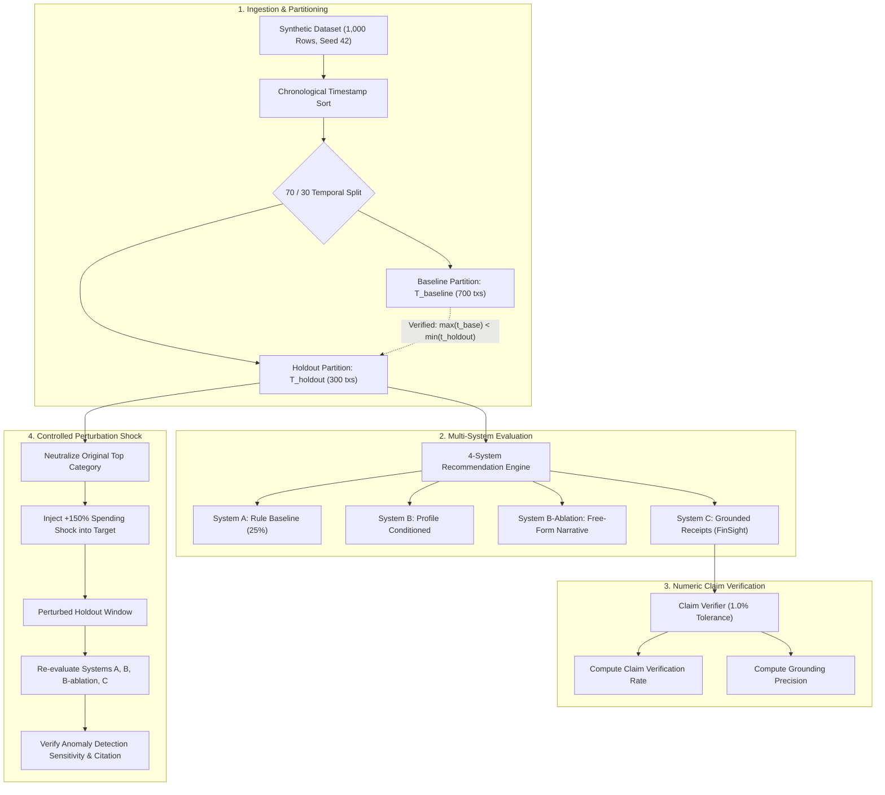

# Empirical Research Protocol & PersonaLedger Benchmark

The FinSight AI Research Laboratory provides a standardized, reproducible experimental framework for evaluating financial recommendation engines, numeric hallucination rates, and anomaly detection sensitivity under strict zero-leakage conditions.

---

## 1. Dataset Provenance: Synthetic Benchmark Inspired by PersonaLedger

The evaluation benchmark is a synthetic multi-persona consumer financial ledger inspired by the PersonaLedger schema, designed to eliminate privacy exposure while maintaining realistic consumer spending characteristics across multiple socioeconomic cohorts.

### 1.1 Generation Parameters
- **Dataset Name:** Synthetic Benchmark inspired by PersonaLedger v1.0
- **Observation Count:** 1,000 discrete transaction records.
- **Temporal Horizon:** 101 calendar days (`2026-01-01` to `2026-04-11`).
- **Cohort Distribution:** 10 synthetic archetypal consumer personas (`syn_user_01` to `syn_user_10`, 83–112 transactions per user, mean = 100.0).
- **Determinism:** Governed by random seed `42` to guarantee exact bitwise reproducibility across platforms.
- **Dataset Integrity Checksum (SHA-256):** `3a3893697b6be0daf3d8f1f56eb60de185ad79c7f26bbf7ce1c2be47c441385a`
- **Reference Artifact:** [`public/sample_personal_ledger.csv`](../public/sample_personal_ledger.csv).

### 1.2 Persona Taxonomy
1. **Conservative Saver (`syn_user_01`):** High liquidity margin, low discretionary consumption, automated savings flows.
2. **Urban Commuter (`syn_user_02`):** Daily micro-transactions, elevated transit and dynamic rideshare expenses.
3. **Digital Nomad (`syn_user_03`):** Multi-currency accommodations, variable income frequency, recurring SaaS overhead.
4. **Healthcare Focused (`syn_user_04`):** Inflexible medication schedules, recurring therapy and insurance disbursements.
5. **Young Professional (`syn_user_05`):** Regular bi-weekly salary, education loan amortizations, weekend hospitality spend.
6. **Family Household (`syn_user_06`):** High grocery variance, seasonal educational/apparel spikes, elevated utilities.
7. **Freelance Creative (`syn_user_07`):** High-variance lump-sum receivables, irregular working-capital outflows.
8. **Student Budget (`syn_user_08`):** Fixed scholarship/stipend allowances, low discretionary spending ceilings.
9. **High-Earner Tech (`syn_user_09`):** High disposable margin, premium electronics acquisition, experiential hospitality.
10. **Transition Period (`syn_user_10`):** Recent employment relocation, temporary residential costs, moving expenses.

---

## 2. Temporal Partitioning & Leakage Prevention

A primary failure mode in machine learning evaluations of financial systems is **temporal data leakage**, where models or baseline statistics incorporate future information unavailable at the decision timestamp.

### 2.1 Formal Partition Contract
Let $\mathcal{T} = \{t_1, t_2, \dots, t_N\}$ represent the set of all transactions ordered chronologically by timestamp $\tau(t_i)$:

$$\mathcal{T}_{\text{baseline}} = \{t_i \mid i \le 0.70 \times N\}$$

$$\mathcal{T}_{\text{holdout}} = \{t_i \mid i > 0.70 \times N\}$$

The partition is validated across the cohort and per user by verifying that no temporal overlap exists:

$$\max_{t \in \mathcal{T}_{\text{baseline}}} \tau(t) < \min_{t \in \mathcal{T}_{\text{holdout}}} \tau(t)$$

The endpoint `GET /research/split` (and `POST /research/split`) executes this check deterministically, returning the exact date ranges, row counts, and per-user partition ratios for both baseline and holdout windows.



---

## 3. Evaluation Metrics & Benchmark Criteria

The platform evaluates the four recommendation configurations dynamically across all 10 personas in the holdout evaluation set. As required by PRD FR-13, every metric displays its exact numerator and denominator:

### 3.1 Decision Agreement Rate (DAR)
The proportion of personas where the system's selected intervention category and action align with ground-truth mathematical thresholds:

$$\text{DAR} = \frac{\text{Agreed Personas}}{\text{Total Personas Evaluated}}$$

### 3.2 Claim Verification Rate (CVR)
The proportion of numerical statements in generated recommendations that exactly match verifiable records in the evidence payload within the strict $\pm 1.0\%$ margin $\epsilon$:

$$\text{CVR} = \frac{|\{c \in \mathcal{C} \mid \exists e \in \mathcal{E} \text{ s.t. } |c - e| / \max(|e|, 10^{-2}) \le 0.010\}|}{|\mathcal{C}|}$$

Where $\mathcal{C}$ is the set of extracted monetary and pace tokens and $\mathcal{E}$ is the set of ground-truth evidence values.

### 3.3 Numeric Hallucination Rate (NHR)
The proportion of evaluated recommendations containing unsupported or invented numerical figures:

$$\text{NHR} = 1.0 - \text{CVR}$$

### 3.4 Protected Invariant Violation Rate (PIVR)
The count and ratio of instances where an engine proposes spending cuts or budget contractions in user-designated protected categories (Groceries, Healthcare, Rent & Housing, Utilities, Education, Insurance):

$$\text{PIVR} = \frac{|\{a \in \mathcal{A} \mid \text{category}(a) \in \mathcal{P}_{\text{protected}}\}|}{|\mathcal{A}|}$$

FinSight AI (System C) and the Rule Baseline (System A) enforce $\text{PIVR} = 0.0$ ($0/10$) as an inviolable system invariant.

---

## 4. Controlled Perturbation Experiment (+150% Shock)

To measure the sensitivity of the recommendation pipelines to genuine behavioral shifts versus noise, the platform executes an empirical controlled perturbation protocol:

```
[ Pre-Perturbation Holdout Window ]
               │
               ▼
   1. Identify & Neutralize Original Top Deviation Category (Pace Scaled to Baseline)
               │
               ▼
   2. Select Target Discretionary Category (e.g. "Subscriptions" / "Dining Out")
               │
               ▼
   3. Inject +150% Inflation (Multiply Target Holdout Amounts by 2.50)
               │
               ▼
[ Perturbed Holdout Transactions ] ──► Re-run Systems A, B, B-ablation, C
                                            │
                                            ▼
                          Sensitivity, Shift Detection & Citation Check
```

### Empirical Protocol Steps:
1. **Neutralization:** The original highest-deviation discretionary category in the holdout window is neutralized by scaling its holdout spending down to match its baseline daily pace (reducing its deviation to 0.0%).
2. **Dynamic Target Selection:** A separate discretionary category active in the holdout window is chosen as the target.
3. **Shock Injection:** Every transaction within that category in $\mathcal{T}_{\text{holdout}}$ is multiplied by $+150\%$ ($a_{\text{new}} = 2.5 \times a_{\text{old}}$), recording exact transaction IDs.
4. **Execution:** All four recommendation systems re-analyze the perturbed holdout partition.
5. **Validation:** 
   - **System A & C** detect the injected category shift as the primary anomaly.
   - **System C** cites the exact perturbed transaction IDs in its evidence payload and accurately reflects the increased monthly impact without hallucinating numbers, passing numeric claim verification.
   - **System B** notices an upward shift but generates advice without itemized transaction citations.
   - **System B-Ablation** produces free-form narrative heuristics without verifiable evidence schema.
